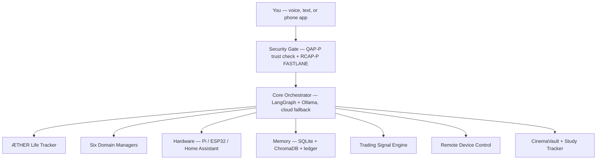
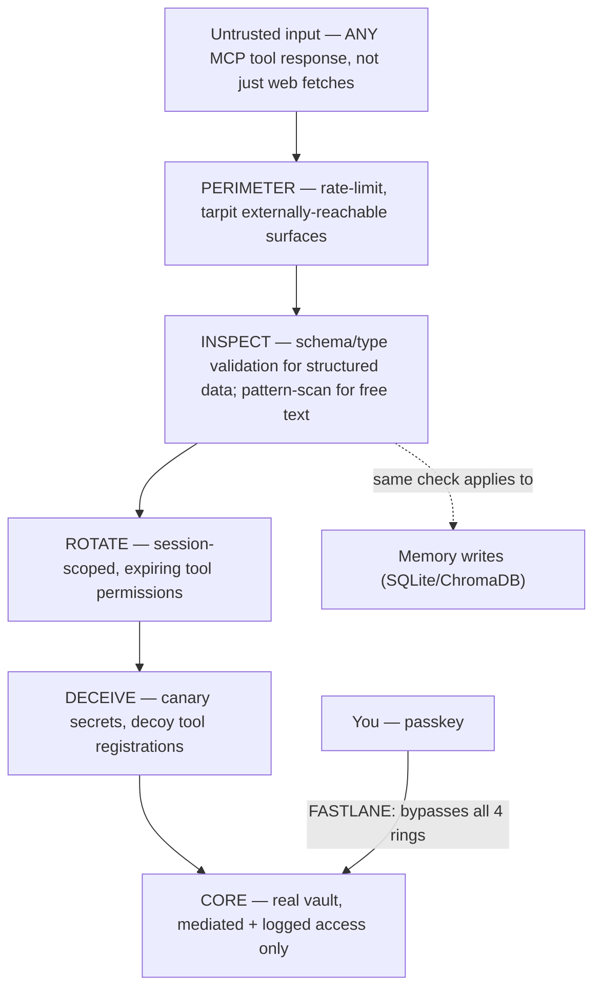

# Eternal — Master Build Plan & Reference

## 0. How to use this document

This is a consolidated handoff from a planning conversation that covered architecture, features, security design, and regulatory research for a personal JARVIS-style assistant called **Eternal**. It's meant to stand on its own — read this first, before re-opening any of the original source files listed in Section 10. Section 8 (Build Phases) is the actionable part; everything before it is context those phases assume.

Owner: Challa Yogeswar. Based in Kadapa, India. Background: 2024 B.Tech ECE, Python/Java/embedded systems (Arduino/Pi/ESP32)/Firebase/REST APIs, Google AI Essentials + Cybersecurity certifications.

---

## 1. Vision

One assistant, **Eternal**, sitting behind a phone/voice/text interface, reachable from anywhere over a private mesh network — never the open internet. Every tool and tracker already built (a life tracker, a movie/media vault, a study tracker) becomes a callable capability instead of a separate silo. Two higher-stakes capabilities — remote device control and an algorithmic trading assistant — sit behind the same gate as everything else. The security layer isn't bolted on afterward; it's built from two original protocols (QAP, RCAP) the owner already designed and wrote up as formal whitepapers, scaled down from enterprise infrastructure to a one-person, few-device deployment.

The name that keeps showing up for the differentiator: **bilingual (English/Telugu) voice + genuinely granular personal life-tracking + real physical hardware control**, in one system. Individually common; together, rare.

---

## 2. Existing Assets — what's already built

| Asset | What it is | Source |
|---|---|---|
| **ÆTHER — Personal Life Tracker** | Full-stack tracker: price monitoring (Amazon/Flipkart/Myntra/Ajio/Meesho scrapers, email+Telegram alerts), habits/streaks/XP & levels, expenses, activity logs (movies, skills, games, YouTube, projects), a life calendar (life-in-weeks view, dream journal, birthdays), achievements/memories. Also now includes a workout/gym tracker (CSV + spreadsheet + log) and a study progress tracker. | `Personal_Tracker.zip`, `TRACKER.zip` |
| **Eternal (Python scaffold)** | LangGraph + Ollama core, Whisper STT, pyttsx3/Coqui/ElevenLabs TTS, openWakeWord, SQLite + ChromaDB memory, three interaction modes (voice/text/FastAPI). Milestone 1 (text-mode core loop) done. Evolved from a bare-bones June 2025 Python script. | `PERSONAL_ASSISTANT.zip` |
| **Personal AI Hub** | Six domain managers (Wellness, Finance, Content, Relationship, Learning, Productivity) behind a central intent router. React/Vite/Tailwind PWA, calls the Anthropic API directly from the client, localStorage, targets Android home-screen install. **Flag:** if there's no backend proxy, the API key is sitting in client-side code — needs fixing before this becomes the front door to tracker/hardware data. | Prior project |
| **CinemaVault** | A personal tool for tracking movies/media. Not yet reviewed in depth — needs its actual interface reviewed before MCP-wrapping in Phase 3. | Named in feature doc |
| **Study progress tracker** | Standalone HTML tool, likely the "study terminal" referenced in the feature doc. | `TRACKER.zip` |
| **QAP whitepaper** (v1.0, May 2026) | *Quiesce-Authorize Protocol* — original zero-trust dynamic-defense protocol, authored by the owner. Full detail in Section 6.1. | `QAP_Whitepaper_CHALLAYOGESWAR.docx` |
| **RCAP whitepaper** (v1.0, July 2026) | *Rotate-Contain-Attribute Protocol* — original concentric-ring admission/containment/attribution protocol, authored by the owner, properly citing prior art (Gupta 2025, Dutta 2025, the deployed Chakravyuh product on India's Maya OS). Full detail in Section 6.2. | `RCAP_Whitepaper_CHALLAYOGESWAR.docx` |
| **Feature-set doc + first QAP-P/RCAP-P draft** | The owner's own first pass at scaling QAP/RCAP down to personal scale, plus a baseline/differentiating feature list. Largely adopted as-is; refined in Section 6.3. | `Untitled_document.md` |
| **Design review + phasing** | A self-produced critical review of the outline: 6 fixes plus a 6-phase, blast-radius-ordered build plan. Fully adopted; this document *is* that plan, extended. | `My_Verdict_on_Outline.md` |

---

## 3. Tech Stack

**Core reasoning**
- Python + LangGraph, running on a **dedicated always-on mini-PC** (not the Raspberry Pi, not the laptop — see Section 6.1 for why)
- Ollama, 3B-class local model as the default
- Claude / GPT-4o as cloud fallback for harder calls

**Voice**
- Whisper STT
- pyttsx3 / Coqui (local, default) — ElevenLabs (cloud) only for non-sensitive output, see Section 6.3
- openWakeWord, wake word "Hey Eternal"
- Bhashini / AI4Bharat models (IndicWhisper, IndicConformer, Svara-TTS) for Telugu

**Data / tracker layer**
- TypeScript / Node.js + Express + Prisma + PostgreSQL (ÆTHER, as already built)
- BullMQ + Redis for scheduled jobs (price checks, nightly maintenance)
- Cheerio + Playwright for scraping

**Frontend**
- React + Vite + Tailwind PWA
- Established visual language across all surfaces: dark space theme, glassmorphism, CRT/retro accents, amber and warm-gold palettes

**Reachability**
- Tailscale mesh (WireGuard) linking phone, laptop, mini-PC, and Pi — private, not internet-exposed, regardless of physical location

**Capability registry**
- MCP servers wrapping every tool: ÆTHER, CinemaVault, the study tracker, the laptop agent, Home Assistant
- New tools onboard via: write a small manifest → wrap as MCP server (template once, reuse) → register → vault issues a scoped token

**Memory**
- SQLite (structured facts) + ChromaDB (semantic recall)
- Git-style versioned diffs with rollback on top
- Sitting on the QAP-P hash-chained, append-only ledger (Section 6.1)

**Trading**
- yfinance, NSE bhavcopy, Kite Connect (data + order APIs)
- pandas, pandas-ta / TA-Lib, mplfinance / Plotly
- backtesting.py / vectorbt

**Security infrastructure**
- Identity: Secure Enclave / Android StrongBox / Windows Hello (hardware already owned, no new procurement)
- Secrets: a real vault issuing short-lived, scoped tokens per capability — never one master key
- Orchestrator: one lightweight daemon on the Raspberry Pi (identity/session/ledger only)

---

## 4. Architecture

**The core design principle:** "seamless" describes your experience talking to Eternal (one conversation, no separate logins, instant reach to anything you've built). It does not describe the permission model underneath. Eternal holds a keyring of many narrow, revocable, capability-scoped tokens — not one master key. Same convenience either way; very different worst case if anything is ever compromised.

**Everything rides the Tailscale mesh.** Phone, laptop, Pi, mini-PC, and Home Assistant all join it. Nothing is reachable from the open internet; devices not on the mesh can't even discover it exists. This is also, functionally, RCAP's FASTLANE — already built, just under a different name.

---

## 5. Feature Set

### 5.1 Baseline (table stakes)
- Persistent, structured, inspectable/editable long-term memory — not just a growing chat log
- Multi-provider LLM routing with fallback
- Voice in/out, optional
- RAG over your own docs and notes — including the whitepapers and this build plan, so Eternal can answer questions about its own design
- Task/reminder/calendar integration
- Web search + page fetch, with fetched content gated through INSPECT before reaching context
- Local-first storage, cloud LLM as the only external dependency by default
- Usage/cost dashboard per LLM provider — this can live right next to the expense tracker; LLM spend is just another expense category
- Multi-device sync (via Tailscale + the shared Postgres/SQLite backends)

### 5.2 Differentiating
- Every existing tool becomes a callable capability instead of a silo (the capability-registry pattern, Section 4)
- Proactive surfacing — off calendar, ILP schedule, and task state, not only responding when asked
- A written **identity-core doc** governing Eternal's persona and tone, with the same rigor given to QAP/RCAP — **not yet drafted, open item**
- A custom persona/UI skin matching the established aesthetic (amber CRT, warm-gold, dark-space/glassmorphism) — **design system not yet chosen, open item**
- Fine-grained per-tool consent instead of all-or-nothing
- Sandboxed execution for anything touching real files or credentials
- Git-style versioned memory with rollback/diff
- A visible, diffable audit trail of every action and why

### 5.3 Domain mapping
The Personal AI Hub's six domain managers map onto ÆTHER's modules almost exactly — this is one system, not six plus a tracker:

| Domain manager | ÆTHER module(s) |
|---|---|
| Wellness | Habits, streaks, workout log |
| Finance | Expenses, price tracker, **trading signal engine** |
| Content | Movies, YouTube, games, CinemaVault |
| Learning | Skills tracker, study progress tracker |
| Relationship | Life calendar, birthdays, achievements/memories |
| Productivity | Projects tracker |

---

## 6. Security Architecture

### 6.1 QAP-P — Identity & Session Layer

Ported from QAP (Quiesce-Authorize Protocol). Mechanics port; enterprise infrastructure does not.

| QAP concept | Personal-scale equivalent |
|---|---|
| Node states (ACTIVE / QUIESCE / QUARANTINE) | Your devices & sessions: laptop, phone, browser session, MCP client |
| TPM-attested load certificate | Hardware key already in your devices — Secure Enclave / StrongBox / Windows Hello |
| Peer-issued Authorization JWT (short-lived, non-replayable nonce) | Your phone, as trusted peer, signs a short-lived token to revive another device's session — passwordless reauth |
| Trust score | Per-device/session score: enrollment age, quarantine history, anomaly count, hardware-key presence. **Gates the sensitive-action tier directly** — a low-trust session can't authorize full laptop control or trade execution even if otherwise authenticated |
| 3-node Raft orchestrator | **One** lightweight daemon on the Pi + an offline, physically-stored recovery key. Uptime redundancy isn't the risk at one-user scale; permanent lockout is |
| IP/protocol-dialect rotation (MTD) | Repurposed as scheduled rotation of LLM and broker API keys |
| Immutable ledger | Hash-chained, append-only SQLite log of every memory write, tool call, and external request — this **is** the audit trail referenced everywhere else in this doc |
| Decoy honeypot | Canary credential planted in config/notes — any session touching it auto-quarantines |
| Chaos engineering | Scheduled self-red-team: spoof a reauth or forged tool call, confirm QUARANTINE fires |

**QUARANTINE recovery — two tiers (fix from design review):**
- **Soft tier:** same enrolled device, new IP/geo, otherwise-normal behavior (e.g., you're traveling) → biometric + a cooldown window
- **Hard tier:** new/unenrolled device, or a geographically-implausible "impossible travel" jump → offline physical recovery key only

### 6.2 RCAP-P — Tool-Use & Data-Flow Layer

Ported from RCAP (Rotate-Contain-Attribute Protocol, Chakravyuh-inspired). This is the layer that matters most for an agentic assistant — its actual job is admitting content you can't yet trust without giving it free rein.

| RCAP ring | Personal-scale role |
|---|---|
| PERIMETER | Rate-limit any externally-reachable surface (webhook, email-triggered agent, web search) |
| INSPECT | **Generalized fix:** gates *every* MCP tool response, not just fetched web pages — a compromised CinemaVault/study-tracker/NSE-data server can return injection-shaped output too. Two methods: strict schema/type validation for structured sources (price feeds, calendar entries — cheaper and stronger), heuristic pattern-scanning for free text (web, email). Flags, never silently strips |
| ROTATE | Scheduled credential rotation + session-scoped, not permanent, tool permissions |
| DECEIVE | Decoy secret / fake tool registration — any touch is unambiguous evidence |
| CORE | Real vault (OS keychain / encrypted file); default tool access never reads it directly, only through a mediated, logged path |
| FASTLANE | You, via passkey, always frictionless. **Every automated routine — including ones you wrote yourself — goes through the full ring stack, no exceptions.** Already implemented as the Tailscale mesh |
| CONTAIN | Ambiguous-but-not-certain flags get sandboxed/dry-run + one manual approval, not a hard crash |
| ATTRIBUTE | Tags *which source* (site, sender, doc template, MCP server) triggered a flag; repeat offenders auto-contained without re-approval |

**Explicitly out of scope, carried forward from RCAP's own spec:** hack-back. Stay entirely passive within your own systems — no attempt to reach into or interfere with whatever infrastructure a detected attacker is using. This matters even more here than in RCAP's original enterprise scope, since there's no legal team behind a personal deployment.

### 6.3 Cross-cutting hardening (fixes from design review, beyond the two protocols above)

1. **Ollama and the QAP-P orchestrator run on different machines.** A Pi 5 can't give good voice-latency tokens/sec for a 3B model, and — independent of performance — co-locating the small, hardened trust root with the much larger LLM-runtime dependency surface (LangGraph, model weights, tool-calling code) undermines the separation the rest of this design depends on. Ollama goes on a **dedicated always-on mini-PC** — not the Pi, and not the laptop (which sleeps constantly and is itself a remote-control target; the assistant's uptime shouldn't depend on the laptop's).

2. **Voice is a separate risk surface from device trust, full stop.** A session being ACTIVE and hardware-attested says nothing about whether the audio is trustworthy — recordings and voice clones bypass device trust entirely. **Sensitive-tier actions (trade execution, full laptop control, physical Home Assistant actions like locks) are never voice-triggerable alone, regardless of trust score.** Require a second, non-voice confirmation — a tap in the phone app, not a spoken "yes." This suspicion extends to the wake-word/STT pipeline itself, not just the final confirmation — a clone can trigger the wake word too.

3. **Outbound data classification** (RCAP-P above only covers inbound). First concrete draft: Finance/trading figures, health-adjacent tracker entries, and dream-journal/memory content stay **local-only** — Coqui/pyttsx3, Ollama, never ElevenLabs or a cloud LLM call. Casual conversational output may use cloud TTS/LLM freely.

4. **Memory writes go through the same INSPECT check as live tool calls.** A bad live tool call fails once. A bad memory write gets re-served as trusted fact on every future recall until someone notices — a much longer-lived compromise. No exception for "it's just going into memory."

### 6.4 What level of security this actually is

Higher than the overwhelming majority of hobbyist assistant projects, which typically have no real threat model at all. This design gets hardware-attested identity, non-replayable peer authorization, tiered trust scoring, an immutable audit trail, injection-aware content admission across *every* tool (not just web), session-scoped credentials instead of standing ones, and scheduled adversarial self-testing — largely for free, by porting QAP/RCAP's mechanics instead of their enterprise infrastructure.

What it isn't, and what no honest design can promise: unhackable. Nothing is. The honest version of "no compromise on security" is not one wall that never falls — it's enough independent layers that a failure in any one of them doesn't take the rest down with it.

---

## 7. Capability-Specific Notes

### 7.1 Remote Device Control

- **Reachability problem, solved once:** Tailscale mesh (WireGuard) — phone, laptop, and Pi get permanent private addresses regardless of network, no port forwarding, no public IP.
- **Laptop agent:** small FastAPI service exposing a *fixed, named* action list only — lock/unlock, sleep/wake, open app X, run script Y, shut down. Never a generic "run this command" endpoint.
- **Full control (screen/mouse/keyboard):** don't build this from scratch. Run it over an existing hardened remote-desktop protocol on the Tailscale network — OS-native remote desktop restricted to Tailscale-only, or self-hosted RustDesk. **Decision not yet made, open item.** Eternal's job is Wake-on-LAN + handoff, not reimplementing remote desktop.
- **Home devices:** Home Assistant joins the same Tailscale mesh; MCP-scoped tool access, reachable from anywhere.
- **Trust gating:** "take over full control of my laptop" is the single most sensitive action in the whole system — the top trust tier, non-voice confirmation always required, plus a kill switch that immediately quarantines every session and revokes every scoped token.

### 7.2 Trading Assistant

**Build (free/open tools):**
- Data: `yfinance` (NSE `.NS` tickers), NSE bhavcopy, or Kite Connect
- Analysis: `pandas` + `pandas-ta`/`TA-Lib` (RSI, MACD, Bollinger Bands, ATR), `mplfinance`/Plotly for charts
- Backtesting: `backtesting.py` or `vectorbt` — mandatory before any real capital is involved
- Signals as explicit, auditable rules, not a black box; an ML layer can sit on top later as a probability score, framed as an edge, not a prediction

**Regulatory landscape (verified, current as of this document):**
- SEBI's algo-trading framework became mandatory for all brokers on April 1, 2026. Retail algorithmic strategies need registration through exchange-approved systems via the broker; API-based strategies are covered, not exempt.
- The static-IP requirement applies specifically to **order placement**. Market data (WebSocket ticks, orderbook, positions) can still be accessed from any IP. **This means: monitoring and position checks stay reachable from the phone anywhere; only the actual buy/sell call must originate from the fixed IP.**
- IP whitelisting is configured at the **developer-account level**, covering every app under that account — not per individual app. One fixed egress point for the whole setup.
- IP changes are limited to **one per calendar week** — whichever machine is the fixed point needs to be genuinely static.
- Daily re-authentication (with 2FA/TOTP) has been Kite Connect's standing requirement for individual API users for a long time — the long-lived refresh token has always been restricted to a small number of exchange-approved platforms, not individual accounts. Not a new April-2026 change, but the practical conclusion is unchanged: **build a real daily re-auth flow into the vault, not a set-and-forget credential.**
- 10 orders/second is the hard rate-limit ceiling per client account; above that, formal exchange registration is required. Personal, self-built, single-account use sits comfortably under this.

**The math correction (important, keep this in view):** any design goal of "recover a loss within a fixed week no matter what" doesn't run on math, it runs against it. Clawing back from a 20–30% drawdown in seven days requires a 25–43% weekly gain — no legitimate strategy, human or algorithmic, targets that. SEBI's own study found roughly 93% of individual F&O traders lost money FY22–FY24 (aggregate losses over ₹1.8 lakh crore), with FY25 losses widening further and under-30 traders the fastest-growing share of that group. The fix is structural, not motivational: fixed-fractional position sizing (1–2% risk/trade, ATR-based), stop-loss and take-profit set at entry and never moved, a max-drawdown circuit breaker that **stops trading for the period** rather than pushing harder, and judging the strategy over dozens of trades and months — never a single week.

**Sequencing:** order placement runs from the fixed-IP home server/mini-PC specifically, never from the phone directly. Live execution is a sensitive-tier action — never voice-triggered, always the phone-tap confirmation. Backtest and paper-trade extensively before any live order, automated or not.

---

## 8. Build Phases

Build in order of blast radius, not order of interest.

### Phase 1 — QAP-P Core Substrate
No assistant logic yet. Prove the trust layer works on its own.
- Device/session state machine (ACTIVE/QUIESCE/QUARANTINE) as a small daemon on the Pi
- Hardware-backed key integration per device
- Peer-issued Authorization flow (phone signs a nonce to revive another device)
- Trust-score model; hash-chained append-only ledger
- Canary credential + scheduled chaos-engineering self-test
- Two-tier QUARANTINE recovery (soft: biometric+cooldown; hard: offline key)
- Vault issuing short-lived, scoped tokens

**Exit criteria:** you can lock/quarantine/revive a session end-to-end using only your phone as authorizer, every transition logged, and a spoofed reauth attempt reliably triggers QUARANTINE.

### Phase 2 — Text-Only Assistant Loop
No writes, no voice, no tool access yet.
- LangGraph + Ollama on the dedicated mini-PC, cloud fallback wired in
- Tailscale-reachable from anywhere
- RAG over your own docs (including this file and the whitepapers)

**Exit criteria:** you can text Eternal from your phone on any network and get a grounded answer referencing your own documents, with zero write access to anything.

### Phase 3 — RCAP-P + First Read-Only Capabilities
- INSPECT/CONTAIN/ATTRIBUTE wired around every tool response, not just web
- PERIMETER rate-limiting on externally-reachable surfaces
- DECEIVE canary tool registration
- CinemaVault and the study tracker registered as read-only MCP servers
- Web search added, results routed through INSPECT

**Exit criteria:** a deliberately malicious test page/document gets flagged and correctly attributed, not silently passed or hard-crashed.

### Phase 4 — Voice + Write-Capable Capabilities
- Whisper STT, wake word, TTS (local by default; data-classification policy enforced)
- ÆTHER wired in as a write-capable MCP capability with per-tool consent + audit trail
- Memory writes routed through the same INSPECT check as live tool calls
- Voice explicitly excluded as sole authorization for anything in the sensitive tier

**Exit criteria:** a spoken command changes tracker data, is logged with an explanation, and no sensitive-tier action can complete on voice alone.

### Phase 5 — Remote Device Control + Home Assistant
- Laptop agent with fixed named actions only
- Full-control sessions over an existing remote-desktop protocol via Tailscale
- Home Assistant on the mesh, MCP-scoped
- Non-voice confirmation required for every physical/full-control action
- Kill switch: one action quarantines every session and revokes every token
- Full session logging

**Exit criteria:** full laptop control and a smart-home action both work from outside the home network, both require the phone-tap confirmation, and the kill switch has actually been tested.

### Phase 6 — Trading: Signals First, Execution Last
**Sub-phase A (no live orders):** data pipeline, indicators, rules-based signals, full backtesting, fixed-fractional position sizing, paper-trading for several weeks minimum.
**Sub-phase B (live, only after A is proven and Phase 5 has run in daily use):** Kite Connect order placement from the fixed-IP home server, daily re-auth flow, stay under 10 orders/sec, execution gated as a sensitive-tier action.

**Exit criteria for going live:** sub-phase A shows a real edge across enough backtested and paper-traded trades to be statistically meaningful — not a good week.

---

## 9. Open Decisions — resolve these, don't assume them

- Vault software: HashiCorp Vault vs. sops/age-encrypted files (leaning toward the latter for solo-scale simplicity)
- Exact mini-PC spec/purchase for Ollama hosting
- RustDesk vs. OS-native remote desktop for full laptop control
- The identity-core doc governing Eternal's persona/tone — not yet drafted
- Concrete UI design system for the established aesthetic (dark-space/glassmorphism/CRT/amber) — direction named, nothing built
- Confirm Zerodha/Kite Connect is the intended broker (all regulatory research in Section 7.2 assumes this); re-verify equivalent rules if a different broker is used
- CinemaVault's and the study tracker's actual internal architecture — not yet reviewed; needed before MCP-wrapping in Phase 3

---

## 10. Source Material

- `Personal_Tracker.zip`, `TRACKER.zip` — ÆTHER life tracker (docs + code)
- `PERSONAL_ASSISTANT.zip` — Eternal Python scaffold + research doc
- `QAP_Whitepaper_CHALLAYOGESWAR.docx` — Quiesce-Authorize Protocol, full spec
- `RCAP_Whitepaper_CHALLAYOGESWAR.docx` — Rotate-Contain-Attribute Protocol, full spec
- `Untitled_document.md` — feature set + first QAP-P/RCAP-P personal-scale mapping
- `My_Verdict_on_Outline.md` — design review, 6 fixes, 6-phase build plan

Bring these into the new project alongside this file for anything that needs the original source detail — this document is the synthesis, not a replacement for them.
